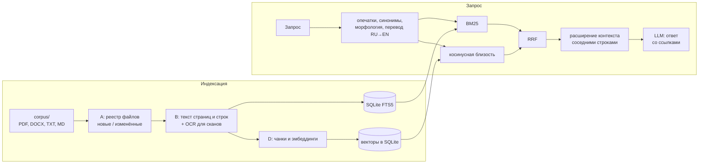

# tech-docs-rag

[](https://github.com/Umorz/tech-docs-rag/actions/workflows/tests.yml)

Локальная система поиска по технической документации (datasheet'ы радиоэлектронных компонентов
и любые другие документы): гибридный поиск **BM25 + эмбеддинги** с объединением через
**Reciprocal Rank Fusion** и ответ языковой модели **со ссылками до строки страницы**.
Работает полностью офлайн: SQLite и Ollama, без облачных сервисов.

Выпускная квалификационная работа бакалавра, Московский политехнический университет, кафедра
автоматики и управления, направление 27.03.04 «Управление в технических системах», 2026:
«Разработка системы поиска документации радиоэлектронных элементов с использованием нейросетей».
Цель - сократить время поиска информации в datasheet'ах, не теряя достоверности: каждый ответ
опирается только на найденные фрагменты и ссылается на них.

## Как устроено



Ключевые решения:

- **SQLite FTS5 как единое хранилище**: инвертированный индекс с BM25, векторы, метаданные и
  ссылки в одном файле, инкрементальная индексация по `mtime` и размеру.
- **RRF вместо смешивания оценок**: BM25 и косинус в несравнимых шкалах, RRF складывает
  `w / (k + ранг)` по каналам.
- **Узкий поиск, широкий контекст**: для ранжирования - короткие чанки (точнее смысловой вектор),
  для языковой модели каждый чанк расширяется соседними строками той же страницы.
- **Перевод запроса**: англоязычные datasheet'ы ищутся и по русскому запросу - запрос переводится
  перед поиском, ответ даётся на языке вопроса.
- **Ссылка = файл : страница : строки**: каждое утверждение ответа можно проверить в источнике.

### Выбор моделей

| Модель эмбеддингов | Размер | Русский | Итог |
|---|---|---|---|
| hash (детерминированный) | - | - | только для тестов конвейера без модели |
| nomic-embed-text | 274 МБ | слабо | быстрая, но промахивается на русских запросах |
| bge-m3 | - | сильно | планировалась основной; Ollama падала с NaN при расчёте эмбеддингов |
| multilingual-e5-large | 2,2 ГБ | сильно | работает, но втрое тяжелее |
| **mxbai-embed-large** | 670 МБ | заявлен | **выбрана**: стабильна, 1024 измерения; слабость на русском компенсирует перевод запроса |

Языковая модель - **T-pro-it-2.1** (Т-Банк, 33 млрд параметров, основа Qwen3-32B, дообучена на
русском), квантизация Q4_K_M, 19,8 ГБ. Закрытые модели (GPT-4, GigaChat) исключены: документация
не должна уходить третьей стороне. T-Lite (8B) быстрее, но заметно слабее на технических вопросах.

## Запуск

Нужны [uv](https://docs.astral.sh/uv/) и [Ollama](https://ollama.com).

```
uv sync --extra web                     # окружение строго по uv.lock
ollama pull mxbai-embed-large           # модель эмбеддингов
ollama pull t-tech/T-pro-it-2.1:q4_k_m  # языковая модель из работы (или любая другая)
```

Положите свои документы в папку `corpus/` (подпапки можно; поддерживаются PDF, DOCX, TXT, MD;
старые `.doc` конвертирует `scripts/convert_doc_to_docx.py` через LibreOffice) и постройте индекс:

```
uv run python scripts/step_a_scan_corpus.py     # какие файлы новые или изменились
uv run python scripts/step_b_index_pages.py     # текст страниц и строк (--ocr для сканов)
uv run python scripts/step_d_embed_chunks.py    # чанки и эмбеддинги
```

Индекс появится в `data/index.sqlite`. Повторный запуск тех же шагов доиндексирует только новые и
изменённые файлы; `scripts/watch_corpus.py` делает это автоматически при изменении папки.

Интерфейсы:

```
uv run streamlit run src/app/web.py             # веб
uv run python Main.py                           # консоль (REPL с командами :help)
uv run --extra desktop python -m src.app.desktop  # окно
```

Опционально: `--extra ocr` (распознавание сканов, нужен установленный Tesseract),
`--extra local-embeddings` (sentence-transformers вместо Ollama).

## Проверка

Корпус для проверки в ВКР - шесть официальных datasheet'ов 8-битных микроконтроллеров AVR
(ATmega8515, ATmega8535, ATmega128, ATmega640/1280/2560 и др.): около 1 200 страниц, 28 000 строк,
9 280 чанков, база около 10 МБ. Каждый запрос прогонялся в четырёх конфигурациях: только BM25;
гибрид с `nomic-embed-text`; гибрид с `mxbai-embed-large`; полная - с расширением контекста и
переводом запроса. Проверка качественная; наблюдения:

- «operating temperature ATmega8515»: поиск находил нужную страницу (Absolute Maximum Ratings), но
  при пятистрочных чанках заголовок и значение попадали в разные фрагменты, и модель отвечала
  «не указано». С расширением контекста - «-55 °C ... +125 °C» со ссылкой на страницу. Отсюда
  приём «узкий поиск, широкий контекст»;
- «какая максимальная рабочая температура у ATmega8515» без перевода: лексический канал не находит
  ничего, кроме названия микросхемы, семантический цепляется за оглавление и errata. С переводом -
  тот же правильный ответ, на русском;
- «сколько памяти flash в ATmega2560» - точный ответ: приём работает не только на одном примере;
- при отсутствии ответа во фрагментах модель отказывается отвечать, а не придумывает.

Время на машине с GPU 12-16 ГБ (T-Pro частично выгружена в оперативную память):

| Этап | Время |
|---|---|
| Индексация 6 PDF (шаги A, B) | 2-5 мин |
| Эмбеддинги корпуса (mxbai-embed-large) | 5-10 мин |
| Перевод запроса | 1-3 с |
| Гибридный поиск top-10 и расширение контекста | < 1 с |
| Ответ модели (5-10 токенов/с) | 10-60 с |

Количественная оценка (размеченный набор вопросов, recall@k и MRR по конфигурациям, точность
ответов и ссылок) - следующий шаг.

### Тесты

```
uv run pytest -v
```

Тесты не требуют Ollama: корпус из PDF, DOCX и TXT создаётся на лету, индекс строится теми же
скриптами с детерминированным хеш-эмбеддером. Проверяются индексация всех форматов и вложенных
папок, ссылка «файл : страница : строка», слияние каналов в гибридном поиске, доиндексация нового
файла и формула RRF. CI запускает тесты и поиск секретов на каждый push.

## Структура

| Путь | Что внутри |
|---|---|
| `src/index/` | Хранилище (`db.py`, `schema.sql`), извлечение текста (`extractors/`), лексический (`search.py`) и семантический (`semantic.py`, `embeddings.py`) поиск, гибрид (`hybrid.py`), обработка запроса (`typos.py`, `synonyms.py`, `morphology.py`), языковая модель (`llm.py`), слежение за папкой (`watcher.py`) |
| `src/app/` | Интерфейсы: веб (Streamlit), консоль, окно (customtkinter) |
| `scripts/` | Шаги индексации A, B, D и поиск из командной строки (C) |
| `data/synonyms.json` | Словарь синонимов RU/EN для технических запросов (редактируемый) |
| `tests/` | Тесты |

## Ограничения

- Семантический канал перебирает векторы целиком (без ANN-индекса по умолчанию) - для десятков
  тысяч чанков достаточно, для миллионов нужен `hnswlib` (`--extra local-embeddings`).
- Таблицы и формулы в PDF извлекаются как текст, без структуры.
